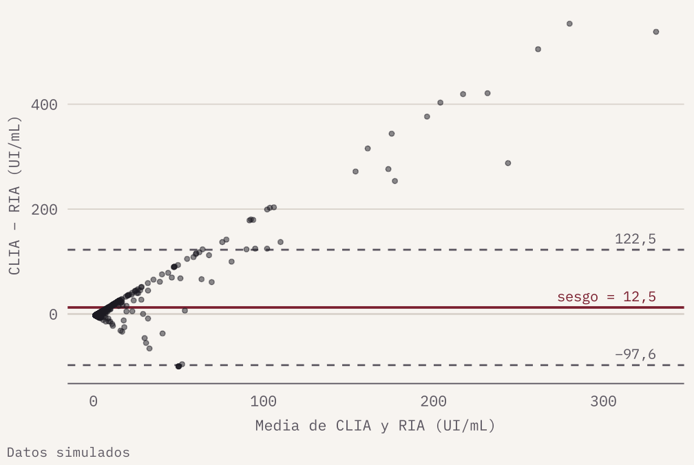
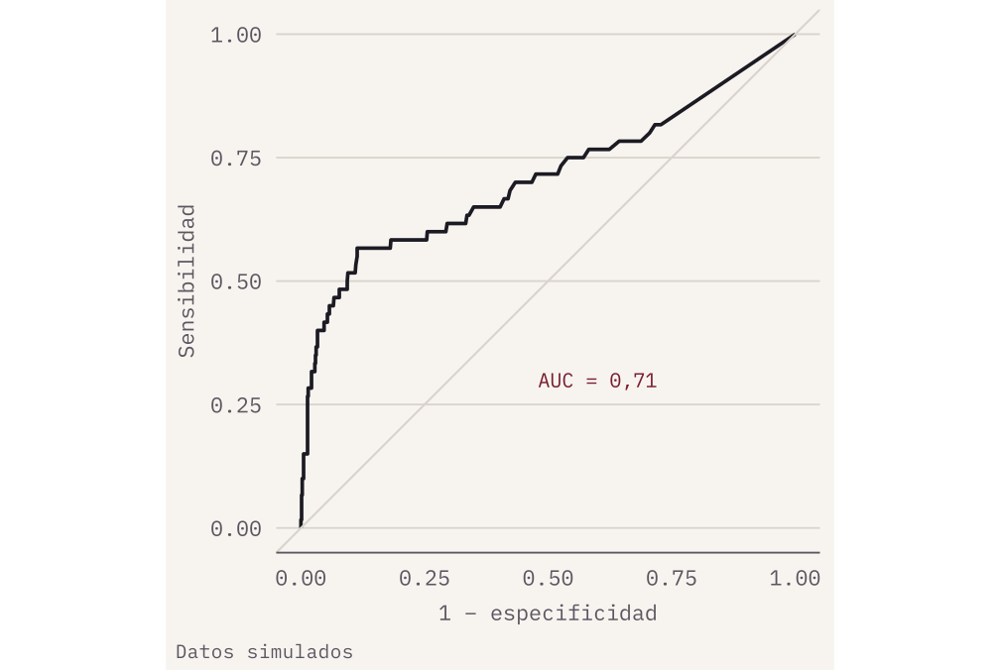
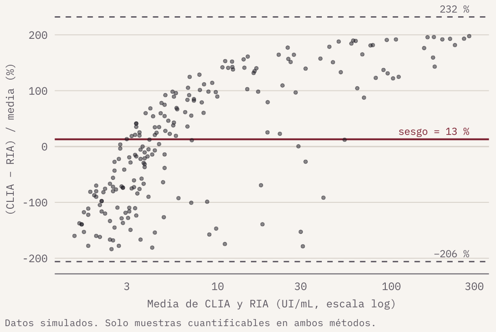
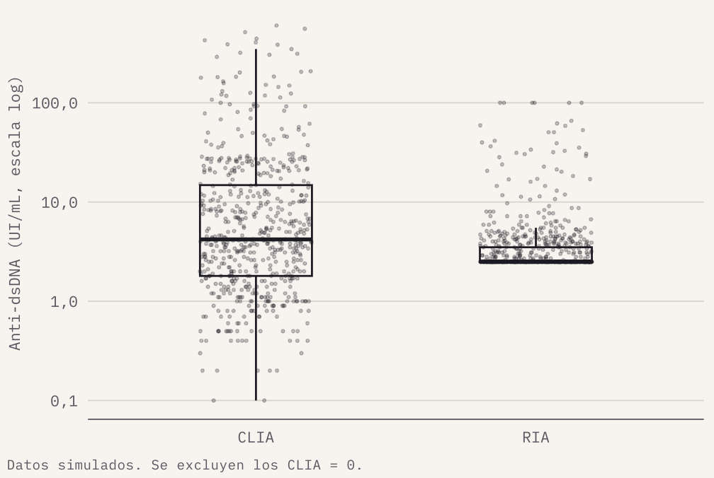

Anti-dsDNA: CLIA frente a radioinmunoanálisis (Farr)
================

- [0. Cabecera](#0-cabecera)
- [1. Configuración](#1-configuración)
  - [Tamaño muestral](#tamaño-muestral)
- [2. Datos](#2-datos)
- [3. Descriptivos](#3-descriptivos)
- [4. Análisis principal](#4-análisis-principal)
  - [4.1. Concordancia cuantitativa](#41-concordancia-cuantitativa)
  - [4.2. Concordancia cualitativa y rendimiento
    diagnóstico](#42-concordancia-cualitativa-y-rendimiento-diagnóstico)
- [5. Análisis secundarios](#5-análisis-secundarios)
  - [5.1. Curva ROC y punto de corte
    alternativo](#51-curva-roc-y-punto-de-corte-alternativo)
  - [5.2. Bland-Altman en porcentaje](#52-bland-altman-en-porcentaje)
  - [5.3. Distribución de los dos
    métodos](#53-distribución-de-los-dos-métodos)
- [6. Figuras](#6-figuras)
- [7. Información de la sesión](#7-información-de-la-sesión)

## 0. Cabecera

**Artículo:** Comparative evaluation of chemiluminescent immunoassay and
radioimmunoassay for the detection of anti-double-stranded DNA
antibodies. *J Rheum Dis* 2025. <https://doi.org/10.4078/jrd.2025.0111>

**Objetivo.** Saber si un inmunoensayo quimioluminiscente (CLIA) puede
sustituir al radioinmunoanálisis de Farr (RIA) en la detección de
anticuerpos anti-dsDNA, tanto en el valor numérico como en la
clasificación positivo/negativo.

**Diseño.** Estudio retrospectivo de comparación de métodos: cada
muestra se midió con los dos métodos. El RIA es el método de referencia.

**Variables principales**

| Variable | Descripción                                                              |
|----------|--------------------------------------------------------------------------|
| `id`     | Identificador ficticio de la muestra                                     |
| `sex`    | Sexo (F/M)                                                               |
| `age`    | Edad en años                                                             |
| `ria`    | Anti-dsDNA por RIA (UI/mL); \< 2,5 se informa como 2,5 y \> 100 como 100 |
| `clia`   | Anti-dsDNA por CLIA (UI/mL); \> 600 se informa como 600                  |

> **Datos simulados.** Este repositorio no contiene datos de pacientes.
> El archivo `data/antidsdna_simulado.csv` lo genera `R/simular_datos.R`
> con la misma estructura que los datos reales. La tabla 2×2 coincide
> con la del artículo por construcción; el resto de cifras se parecen,
> pero no son las publicadas.

## 1. Configuración

Todas las decisiones del estudio están aquí, en un solo sitio.

``` r
library(dplyr)
library(tidyr)
library(ggplot2)
library(pROC)  # curvas ROC
library(epiR)  # sensibilidad, especificidad y valores predictivos con IC 95 %
library(AER)   # regresión Tobit
library(pwr)   # tamaño muestral

source("R/theme_pmenor.R")
usar_pmenor(base_size = 12, fondo = "papel")

set.seed(2019)

# Límites analíticos (insertos de los fabricantes)
RIA_LOQ  <- 2.5   # límite inferior de cuantificación del RIA (UI/mL)
RIA_MAX  <- 100   # límite superior del RIA
CLIA_MAX <- 600   # límite superior del CLIA

# Puntos de corte de positividad de cada fabricante
RIA_CUT  <- 7     # RIA positivo si > 7 UI/mL
CLIA_CUT <- 29    # CLIA positivo si > 29 UI/mL
```

### Tamaño muestral

Calculado antes del estudio a partir de un trabajo previo (n = 583) en
el que el RIA detectó un 4,3 % de positivos y un método equivalente al
CLIA, un 12,0 %.

``` r
# Diferencia entre dos proporciones (h de Cohen), bilateral, alfa 0,05, potencia 80 %
h <- ES.h(p1 = 0.120, p2 = 0.043)
n_props <- pwr.2p.test(h = h, power = 0.80, sig.level = 0.05)
ceiling(n_props$n) * 2   # total de muestras
```

    #> [1] 376

Para la parte cuantitativa (comparación de métodos), el criterio no es
un cálculo de potencia para una correlación, sino la guía **CLSI EP09**:
al menos 40 muestras de pacientes, preferiblemente 100, que cubran el
intervalo de medida de los dos métodos. Lo importante no es solo cuántas
muestras hay, sino cuántas tienen un valor cuantificable en ambos
métodos.

``` r
EP09_MIN <- 40
EP09_REC <- 100

if (!file.exists("data/antidsdna_simulado.csv")) source("R/simular_datos.R")
antidsdna_raw <- read.csv("data/antidsdna_simulado.csv")
n_quantifiable <- with(antidsdna_raw,
  sum(ria > RIA_LOQ & ria < RIA_MAX & clia > 0 & clia < CLIA_MAX))

c(total = nrow(antidsdna_raw), quantifiable_both = n_quantifiable,
  ep09_min = EP09_MIN, ep09_recommended = EP09_REC)
```

    #>             total quantifiable_both          ep09_min  ep09_recommended 
    #>               807               205                40               100

Con 807 muestras se cumplen el mínimo del cálculo de proporciones y el
de EP09. Pero casi dos tercios de los RIA están por debajo del límite de
cuantificación: las muestras con valor medible en los dos métodos son
muchas menos y se concentran en la zona baja. Por eso la parte
cuantitativa (sección 4.1) hay que leerla con cautela.

> **Nota.** `pwr.2p.test()` trata las dos proporciones como si vinieran
> de grupos independientes. Aquí cada muestra se mide con los dos
> métodos, y un diseño pareado suele necesitar menos muestras, así que
> el cálculo es conservador. El cálculo pareado exacto (McNemar) exige
> conocer de antemano la proporción de discordantes, que no estaba
> disponible.

## 2. Datos

``` r
antidsdna <- read.csv("data/antidsdna_simulado.csv")

antidsdna <- antidsdna |>
  mutate(
    ria_pos  = ria  > RIA_CUT,
    clia_pos = clia > CLIA_CUT
  )

glimpse(antidsdna)
```

    #> Rows: 807
    #> Columns: 7
    #> $ id       <chr> "S001", "S002", "S003", "S004", "S005", "S006", "S007", "S008…
    #> $ sex      <chr> "M", "F", "F", "M", "F", "F", "F", "M", "F", "M", "F", "F", "…
    #> $ age      <int> 82, 67, 47, 57, 15, 52, 42, 33, 78, 28, 74, 50, 62, 63, 40, 7…
    #> $ ria      <dbl> 7.8, 4.3, 2.5, 2.7, 2.5, 2.5, 3.4, 4.9, 2.5, 2.9, 2.5, 2.9, 2…
    #> $ clia     <dbl> 427.0, 183.6, 0.0, 0.3, 0.0, 2.6, 0.2, 1.3, 0.0, 0.0, 6.2, 26…
    #> $ ria_pos  <lgl> TRUE, FALSE, FALSE, FALSE, FALSE, FALSE, FALSE, FALSE, FALSE,…
    #> $ clia_pos <lgl> TRUE, TRUE, FALSE, FALSE, FALSE, FALSE, FALSE, FALSE, FALSE, …

## 3. Descriptivos

``` r
# Población
antidsdna |>
  summarise(
    n          = n(),
    female_pct = round(100 * mean(sex == "F"), 1),
    age_median = median(age),
    age_q1     = quantile(age, 0.25),
    age_q3     = quantile(age, 0.75)
  )
```

    #>     n female_pct age_median age_q1 age_q3
    #> 1 807       77.9         53     40     64

``` r
# Distribución de cada método (tabla 1 del artículo)
antidsdna |>
  pivot_longer(c(ria, clia), names_to = "method", values_to = "value") |>
  group_by(method) |>
  summarise(min = min(value), q1 = quantile(value, 0.25), median = median(value),
            mean = round(mean(value), 1), max = max(value))
```

    #> # A tibble: 2 × 6
    #>   method   min    q1 median  mean   max
    #>   <chr>  <dbl> <dbl>  <dbl> <dbl> <dbl>
    #> 1 clia     0     0      2.4  17.5   600
    #> 2 ria      2.5   2.5    2.5   5     100

``` r
# Resultados censurados: se informan con el valor del límite
antidsdna |>
  summarise(
    ria_below_loq  = sum(ria <= RIA_LOQ),
    ria_above_max  = sum(ria >= RIA_MAX),
    clia_above_max = sum(clia >= CLIA_MAX)
  )
```

    #>   ria_below_loq ria_above_max clia_above_max
    #> 1           522             6              1

Casi dos tercios de los RIA están en el límite inferior (2,5 UI/mL). Esa
acumulación de empates condiciona todo el análisis cuantitativo que
sigue.

## 4. Análisis principal

### 4.1. Concordancia cuantitativa

**Correlación de Spearman.** Se usa Spearman y no Pearson porque las dos
distribuciones son muy asimétricas. Aun así, la correlación mide
asociación, no concordancia: dos métodos pueden estar muy
correlacionados y dar valores distintos.

``` r
cor.test(antidsdna$ria, antidsdna$clia, method = "spearman", exact = FALSE)
```

    #> 
    #>  Spearman's rank correlation rho
    #> 
    #> data:  antidsdna$ria and antidsdna$clia
    #> S = 81501923, p-value = 0.0483
    #> alternative hypothesis: true rho is not equal to 0
    #> sample estimates:
    #>        rho 
    #> 0.06953687

**Passing-Bablok.** Es la regresión habitual para comparar métodos, pero
necesita una relación lineal y continua entre ellos. Con dos tercios de
los RIA empatados en 2,5 UI/mL y un CLIA con cola muy larga, no se
cumple, y en el artículo no llegó a converger. Por eso no se ajusta aquí
y se pasa a Bland-Altman y a Tobit.

**Bland-Altman.** Responde a la pregunta clínica: para una muestra
concreta, ¿cuánto puede diferir un método del otro?

``` r
ba <- antidsdna |>
  mutate(avg = (clia + ria) / 2, diff = clia - ria)

bias  <- mean(ba$diff)
loa   <- bias + c(-1.96, 1.96) * sd(ba$diff)

round(c(bias = bias, loa_lower = loa[1], loa_upper = loa[2]), 2)
```

    #>      bias loa_lower loa_upper 
    #>     12.47    -97.55    122.50

``` r
ggplot(ba, aes(avg, diff)) +
  geom_hline(yintercept = 0, colour = pmenor_col[["linea"]]) +
  geom_hline(yintercept = loa, linetype = "dashed") +
  geom_hline(yintercept = bias, colour = pmenor_col[["burdeos"]],
             linewidth = grosor_pmenor(4)) +
  geom_point(alpha = 0.5, size = 1.4) +
  annotate("text", x = max(ba$avg), y = bias, vjust = -0.6, hjust = 1,
           label = paste("sesgo =", numeros_pmenor(accuracy = 0.1)(bias)), colour = pmenor_col[["burdeos"]]) +
  annotate("text", x = max(ba$avg), y = loa, vjust = -0.6, hjust = 1,
           label = numeros_pmenor(accuracy = 0.1)(loa)) +
  labs(x = "Media de CLIA y RIA (UI/mL)", y = "CLIA − RIA (UI/mL)",
       caption = "Datos simulados")
```

<figure>

<figcaption aria-hidden="true">Bland-Altman: CLIA − RIA.</figcaption>
</figure>

**Regresión Tobit.** Tiene en cuenta que los valores de CLIA por encima
de 600 UI/mL están censurados (el valor real es mayor que el informado).

``` r
tobit_fit <- tobit(clia ~ ria, left = -Inf, right = CLIA_MAX, data = antidsdna)
summary(tobit_fit)
```

    #> 
    #> Call:
    #> tobit(formula = clia ~ ria, left = -Inf, right = CLIA_MAX, data = antidsdna)
    #> 
    #> Observations:
    #>          Total  Left-censored     Uncensored Right-censored 
    #>            807              0            806              1 
    #> 
    #> Coefficients:
    #>             Estimate Std. Error z value Pr(>|z|)    
    #> (Intercept) 10.07547    2.17978   4.622 3.80e-06 ***
    #> ria          1.47734    0.18564   7.958 1.74e-15 ***
    #> Log(scale)   4.02435    0.02492 161.481  < 2e-16 ***
    #> ---
    #> Signif. codes:  0 '***' 0.001 '**' 0.01 '*' 0.05 '.' 0.1 ' ' 1
    #> 
    #> Scale: 55.94 
    #> 
    #> Gaussian distribution
    #> Number of Newton-Raphson Iterations: 3 
    #> Log-likelihood: -4390 on 3 Df
    #> Wald-statistic: 63.33 on 1 Df, p-value: 1.7446e-15

### 4.2. Concordancia cualitativa y rendimiento diagnóstico

Con los puntos de corte de cada fabricante y el RIA como referencia.

``` r
# Filas: CLIA (prueba); columnas: RIA (referencia). Positivos primero.
tab_2x2 <- table(
  CLIA = factor(antidsdna$clia_pos, levels = c(TRUE, FALSE), labels = c("+", "-")),
  RIA  = factor(antidsdna$ria_pos,  levels = c(TRUE, FALSE), labels = c("+", "-"))
)
tab_2x2
```

    #>     RIA
    #> CLIA   +   -
    #>    +  27  43
    #>    -  33 704

**Kappa de Cohen y PABAK.** El kappa corrige el acuerdo por azar, pero
con pocos positivos (en torno al 7 %) baja aunque los métodos coincidan
en la mayoría de muestras. El PABAK ajusta por prevalencia y sesgo, y se
da a la vez para que se vea el efecto.

``` r
agreement <- function(tab) {
  n  <- sum(tab)
  po <- sum(diag(tab)) / n                         # acuerdo observado
  pe <- sum(rowSums(tab) * colSums(tab)) / n^2     # acuerdo esperado por azar
  c(po = po, kappa = (po - pe) / (1 - pe), pabak = 2 * po - 1)
}
round(agreement(tab_2x2), 3)
```

    #>    po kappa pabak 
    #> 0.906 0.365 0.812

``` r
diag_metrics <- function(tab) {
  epi.tests(tab, method = "exact", conf.level = 0.95)$detail |>
    filter(statistic %in% c("se", "sp", "pv.pos", "pv.neg", "lr.pos", "lr.neg", "diag.ac")) |>
    mutate(across(c(est, lower, upper), \(x) round(x, 2)))
}
diag_metrics(tab_2x2)
```

    #>   statistic  est lower upper
    #> 1        se 0.45  0.32  0.58
    #> 2        sp 0.94  0.92  0.96
    #> 3   diag.ac 0.91  0.88  0.93
    #> 4    pv.pos 0.39  0.27  0.51
    #> 5    pv.neg 0.96  0.94  0.97
    #> 6    lr.pos 7.82  5.22 11.70
    #> 7    lr.neg 0.58  0.46  0.73

## 5. Análisis secundarios

### 5.1. Curva ROC y punto de corte alternativo

¿Mejora el CLIA si se cambia su punto de corte? Se busca el umbral que
maximiza el índice de Youden (sensibilidad + especificidad − 1).

``` r
roc_clia <- roc(response = antidsdna$ria_pos, predictor = antidsdna$clia,
                levels = c(FALSE, TRUE), direction = "<", quiet = TRUE)
roc_clia
```

    #> 
    #> Call:
    #> roc.default(response = antidsdna$ria_pos, predictor = antidsdna$clia,     levels = c(FALSE, TRUE), direction = "<", quiet = TRUE)
    #> 
    #> Data: antidsdna$clia in 747 controls (antidsdna$ria_pos FALSE) < 60 cases (antidsdna$ria_pos TRUE).
    #> Area under the curve: 0.7087

``` r
ci.auc(roc_clia)
```

    #> 95% CI: 0.6229-0.7945 (DeLong)

``` r
youden <- coords(roc_clia, x = "best", best.method = "youden",
                 best.policy = "omit", transpose = FALSE,
                 ret = c("threshold", "sensitivity", "specificity"))
youden
```

    #>   threshold sensitivity specificity
    #> 1     21.75   0.5666667   0.8862115

``` r
ggroc(roc_clia, legacy.axes = TRUE, colour = pmenor_col[["tinta"]],
      linewidth = grosor_pmenor(4)) +
  geom_abline(slope = 1, intercept = 0, colour = pmenor_col[["linea"]]) +
  annotate("text", x = 0.6, y = 0.3, colour = pmenor_col[["burdeos"]],
           label = paste("AUC =", numeros_pmenor(accuracy = 0.01)(auc(roc_clia)))) +
  coord_equal() +
  labs(x = "1 − especificidad", y = "Sensibilidad", caption = "Datos simulados")
```

<figure>

<figcaption aria-hidden="true">Curva ROC del CLIA frente al
RIA.</figcaption>
</figure>

Rendimiento con el punto de corte de Youden:

``` r
youden_cut <- youden$threshold[1]

tab_youden <- table(
  CLIA = factor(antidsdna$clia > youden_cut, levels = c(TRUE, FALSE), labels = c("+", "-")),
  RIA  = factor(antidsdna$ria_pos,           levels = c(TRUE, FALSE), labels = c("+", "-"))
)
tab_youden
```

    #>     RIA
    #> CLIA   +   -
    #>    +  34  85
    #>    -  26 662

``` r
round(agreement(tab_youden), 3)
```

    #>    po kappa pabak 
    #> 0.862 0.312 0.725

``` r
diag_metrics(tab_youden)
```

    #>   statistic  est lower upper
    #> 1        se 0.57  0.43  0.69
    #> 2        sp 0.89  0.86  0.91
    #> 3   diag.ac 0.86  0.84  0.89
    #> 4    pv.pos 0.29  0.21  0.38
    #> 5    pv.neg 0.96  0.95  0.98
    #> 6    lr.pos 4.98  3.70  6.71
    #> 7    lr.neg 0.49  0.37  0.65

> El punto de corte de Youden sale de los mismos datos con los que se
> evalúa, así que su rendimiento está sobrestimado. Es exploratorio:
> habría que validarlo en otra muestra antes de usarlo.

### 5.2. Bland-Altman en porcentaje

En el Bland-Altman de la sección 4.1 la dispersión crece con la
concentración: una diferencia de 50 UI/mL no pesa igual a 10 que a 400
UI/mL. Expresar la diferencia en porcentaje de la media corrige ese
efecto.

Se limita a las muestras con valor cuantificable en los dos métodos (las
mismas del bloque EP09). Con un RIA informado como 2,5 o un CLIA de 0,
el porcentaje se va a ±200 % por puro artefacto del límite, no por
desacuerdo real.

``` r
ba_pct <- antidsdna |>
  filter(ria > RIA_LOQ, ria < RIA_MAX, clia > 0, clia < CLIA_MAX) |>
  mutate(avg = (clia + ria) / 2,
         diff_pct = 100 * (clia - ria) / avg)

bias_pct <- mean(ba_pct$diff_pct)
loa_pct  <- bias_pct + c(-1.96, 1.96) * sd(ba_pct$diff_pct)

round(c(n = nrow(ba_pct), bias_pct = bias_pct,
        loa_lower = loa_pct[1], loa_upper = loa_pct[2]), 1)
```

    #>         n  bias_pct loa_lower loa_upper 
    #>     205.0      13.0    -206.1     232.0

``` r
ggplot(ba_pct, aes(avg, diff_pct)) +
  geom_hline(yintercept = 0, colour = pmenor_col[["linea"]]) +
  geom_hline(yintercept = loa_pct, linetype = "dashed") +
  geom_hline(yintercept = bias_pct, colour = pmenor_col[["burdeos"]],
             linewidth = grosor_pmenor(4)) +
  geom_point(alpha = 0.5, size = 1.4) +
  annotate("text", x = max(ba_pct$avg), y = bias_pct, vjust = -0.6, hjust = 1,
           label = paste0("sesgo = ", numeros_pmenor(accuracy = 1)(bias_pct), " %"),
           colour = pmenor_col[["burdeos"]]) +
  annotate("text", x = max(ba_pct$avg), y = loa_pct, vjust = -0.6, hjust = 1,
           label = paste0(numeros_pmenor(accuracy = 1)(loa_pct), " %")) +
  scale_x_log10(labels = numeros_pmenor()) +
  labs(x = "Media de CLIA y RIA (UI/mL, escala log)",
       y = "(CLIA − RIA) / media (%)",
       caption = "Datos simulados. Solo muestras cuantificables en ambos métodos.")
```

<figure>

<figcaption aria-hidden="true">Bland-Altman en porcentaje (muestras
cuantificables en ambos métodos).</figcaption>
</figure>

Si los límites en porcentaje siguen siendo muy amplios, la falta de
concordancia no se debe solo a las muestras con concentraciones altas:
los métodos discrepan en todo el intervalo de medida.

### 5.3. Distribución de los dos métodos

``` r
antidsdna |>
  pivot_longer(c(ria, clia), names_to = "method", values_to = "value") |>
  filter(value > 0) |>   # el logaritmo de 0 no existe: se excluyen los CLIA = 0
  mutate(method = toupper(method)) |>
  ggplot(aes(method, value)) +
  geom_jitter(width = 0.2, alpha = 0.25, size = 0.8) +
  geom_boxplot(width = 0.4, outlier.shape = NA, linewidth = grosor_pmenor(3)) +
  scale_y_log10(labels = numeros_pmenor()) +
  labs(x = NULL, y = "Anti-dsDNA (UI/mL, escala log)",
       caption = "Datos simulados. Se excluyen los CLIA = 0.")
```

<figure>

<figcaption aria-hidden="true">Distribución de anti-dsDNA por método
(escala logarítmica).</figcaption>
</figure>

## 6. Figuras

Las figuras se guardan en `output/` al ejecutar el documento (secciones
4 y 5).

## 7. Información de la sesión

``` r
sessionInfo()
```

    #> R version 4.3.3 (2024-02-29)
    #> Platform: x86_64-pc-linux-gnu (64-bit)
    #> Running under: Ubuntu 24.04.5 LTS
    #> 
    #> Matrix products: default
    #> BLAS:   /usr/lib/x86_64-linux-gnu/blas/libblas.so.3.12.0 
    #> LAPACK: /usr/lib/x86_64-linux-gnu/lapack/liblapack.so.3.12.0
    #> 
    #> locale:
    #>  [1] LC_CTYPE=C.UTF-8       LC_NUMERIC=C           LC_TIME=C.UTF-8       
    #>  [4] LC_COLLATE=C.UTF-8     LC_MONETARY=C.UTF-8    LC_MESSAGES=C.UTF-8   
    #>  [7] LC_PAPER=C.UTF-8       LC_NAME=C              LC_ADDRESS=C          
    #> [10] LC_TELEPHONE=C         LC_MEASUREMENT=C.UTF-8 LC_IDENTIFICATION=C   
    #> 
    #> time zone: Atlantic/Canary
    #> tzcode source: system (glibc)
    #> 
    #> attached base packages:
    #> [1] stats     graphics  grDevices utils     datasets  methods   base     
    #> 
    #> other attached packages:
    #>  [1] pwr_1.3-0      AER_1.2-12     sandwich_3.1-0 lmtest_0.9-40  zoo_1.8-12    
    #>  [6] car_3.1-2      carData_3.0-5  epiR_2.0.67    survival_3.5-8 pROC_1.18.5   
    #> [11] ggplot2_3.4.4  tidyr_1.3.1    dplyr_1.1.4   
    #> 
    #> loaded via a namespace (and not attached):
    #>  [1] tidyselect_1.2.0        farver_2.1.1            fastmap_1.1.1          
    #>  [4] fontquiver_0.2.1        promises_1.2.1          digest_0.6.34          
    #>  [7] timechange_0.3.0        mime_0.12               lifecycle_1.0.4        
    #> [10] sf_1.0-15               gfonts_0.2.0            ellipsis_0.3.2         
    #> [13] magrittr_2.0.3          compiler_4.3.3          rlang_1.1.3            
    #> [16] tools_4.3.3             utf8_1.2.4              yaml_2.3.8             
    #> [19] data.table_1.14.10      knitr_1.45              askpass_1.2.0          
    #> [22] labeling_0.4.3          classInt_0.4-10         curl_5.2.0             
    #> [25] plyr_1.8.9              xml2_1.3.6              abind_1.4-5            
    #> [28] KernSmooth_2.23-22      httpcode_0.3.0          withr_2.5.0            
    #> [31] purrr_1.0.2             grid_4.3.3              fansi_1.0.5            
    #> [34] gdtools_0.3.5           xtable_1.8-4            e1071_1.7-14           
    #> [37] colorspace_2.1-0        scales_1.3.0            crul_1.4.0             
    #> [40] cli_3.6.2               rmarkdown_2.25          crayon_1.5.2           
    #> [43] ragg_1.2.7              generics_0.1.3          DBI_1.2.2              
    #> [46] proxy_0.4-27            pander_0.6.5            splines_4.3.3          
    #> [49] BiasedUrn_2.0.11        vctrs_0.6.5             Matrix_1.6-5           
    #> [52] jsonlite_1.8.8          fontBitstreamVera_0.1.1 Formula_1.2-5          
    #> [55] systemfonts_1.0.5       units_0.8-5             glue_1.7.0             
    #> [58] lubridate_1.9.3         flextable_0.9.4         gtable_0.3.4           
    #> [61] later_1.3.2             munsell_0.5.0           tibble_3.2.1           
    #> [64] pillar_1.9.0            htmltools_0.5.7         openssl_2.1.1          
    #> [67] R6_2.5.1                textshaping_0.3.7       evaluate_0.23          
    #> [70] shiny_1.8.0             lattice_0.22-5          highr_0.10             
    #> [73] fontLiberation_0.1.0    httpuv_1.6.14           class_7.3-22           
    #> [76] Rcpp_1.0.12             zip_2.3.1               uuid_1.2-0             
    #> [79] officer_0.6.4           xfun_0.41               pkgconfig_2.0.3
